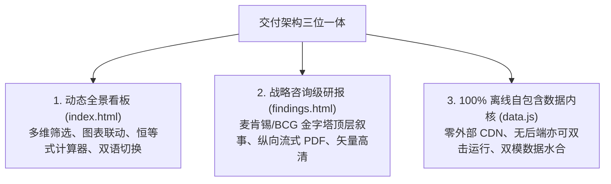
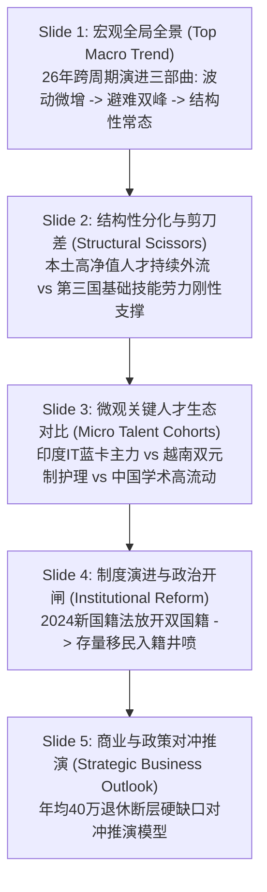

# AI Agent 智能分析看板研发与调教标准作业规程 (Agent Playbook & SOP)
> **Germany Migration Intelligence Dashboard — AI Agent Golden Reference Blueprint**  
> 本手册为后续基于官方统计数据构建跨国人口迁移与宏观数据分析系统（或拓展至日本、英国、法国、加拿大、新加坡等其他国家）的**标准化研发、调教规范与避坑红线指南**。

---

## 目录
1. [项目顶层哲学与设计架构 (Architecture Philosophy)](#1-项目顶层哲学与设计架构)
2. [数据工程与官方口径校验标准 (Data Engineering Standard)](#2-数据工程与官方口径校验标准)
3. [Agent 调教红线：视觉防溢出与抗碰撞规范 (Visual & Anti-Collision Guardrails)](#3-agent-调教红线视觉防溢出与抗碰撞规范)
4. [战略咨询级叙事结构设计 (Executive Consulting Deck Design)](#4-战略咨询级叙事结构设计)
5. [四层自动化质量审核流水线 (Automated 4-Tier Audit Pipeline)](#5-四层自动化质量审核流水线)
6. [复刻拓展至其他国家的全流程清单 (Generalizing to Other Countries SOP)](#6-复刻拓展至其他国家的全流程清单)

---

## 1. 项目顶层哲学与设计架构

未来的 AI Agent 在接到类似需求时，必须严格贯彻**“三位一体”的交付架构**，拒绝仅产出静态文字、图片或脆弱的外部依赖原型：



### 核心设计原则：
1. **100% 离线可用 (Zero-Dependency Offline Support)**：
   * 所有第三方可视化引擎（如 `vendor/echarts.min.js`）、地图矢量（如 `vendor/germany_map.js`）、清洗后的结构化数据（`data.js`）、国际化字典（`i18n.js`）**必须全部本地打包**。
   * 前端代码必须实现双模兼容：在 `file://` 协议（直接双击 HTML 打开）与 `http://` 协议（Web 服务器启动）下均能 100% 正常运行，坚决不能因未起服务器导致页面白屏或跨域报错。
2. **纯正中英双语国际化 (True i18n)**：
   * 默认语言必须为简体中文，右上角设置持久化切换按钮（`localStorage`）。
   * 采用统一的 `i18n.js` 字典驱动，严禁中文与英文硬编码混杂在组件中。
   * 官方统计代码（如 Destatis 表号 `12711-0005`）必须严格保留，不得随语言切换被误翻译。

---

## 2. 数据工程与官方口径校验标准

构建任何国家移民数据平台时，严禁使用虚构或未经校验的网络传闻数据。必须直接对接该国官方统计局（如德国 Destatis、英国 ONS、法国 INSEE、日本 e-Stat 等）：

### 核心恒等式校验约束
在清洗与入库阶段，必须在代码层强制校验以下数学恒等式（误差必须为 0 或因修约控制在极微小容差内）：

$$\text{Net Migration (Saldo)} = \text{Inflow (Zuzüge)} - \text{Outflow (Fortzüge)}$$

$$\text{Total Inflow} = \text{Inflow}_{\text{Citizens}} + \text{Inflow}_{\text{EU/Region}} + \text{Inflow}_{\text{Third-Country}}$$

$$\Delta \text{Net Migration} = \Delta \text{Inflow} - \Delta \text{Outflow}$$

### 区分年度与月度统计口径
* **已发布年度数据 (Full-Year Annual Accounts)**：为最终核算或官方年度初步核算（如 2025 Preliminary）。
* **最新月度数据 (Monthly YTD Accounts)**：必须明确提示为**部分月份累计初步值**（如 2026年1—8月累计），**严禁直接将 8 个月累计与历史完整年度并列对比或称作“全年”**。
* **国籍细分可比性**：月度数据中若官方未公开单国籍细分（如中国、印度），必须在界面上标注口径说明，不得混淆。

---

## 3. Agent 调教红线：视觉防溢出与抗碰撞规范

> [!CAUTION]
> **本节为用户经过多次反馈后形成的绝对红线！未来的 Agent 在编写前端与可视化代码时，必须逐条对照执行，违者重构！**

### 3.1 KPI 卡片与文本防溢出规范 (Bounding Box Safety)
1. **拒绝单行拥挤网格 (No Flat Single-Row Grids)**：
   * ❌ **错误做法**：将 7 张卡片塞进一个 `grid-template-columns: repeat(auto-fit, minmax(190px, 1fr))`。在宽屏下会排成 6+1 结构，第二行孤零零留下一张孤儿卡片，且单卡内容宽度被挤压至不足 180px。
   * ✅ **正确做法**：采用**结构化两层网格 (Balanced 2-Tier Grid)**：
     * **第一层（宏观年度指标）**：4 张卡片，分配 4 等分网格（`repeat(4, minmax(0, 1fr))`）；
     * **第二层（人群细分前瞻）**：3 张卡片，分配 3 等分网格（`repeat(3, minmax(0, 1fr))`）；
     * 保证每张卡片可用宽度稳定在 320px~430px 以上，留白充足、左右对称。
2. **Footer 强制允许折行**：
   * ❌ **错误做法**：`.kpi-footer { display: flex; justify-content: space-between; }`，子元素带 `white-space: nowrap`。
   * ✅ **正确做法**：必须加入 `flex-wrap: wrap; gap: 0.4rem; min-width: 0;`。当屏幕收缩时，右侧徽章优雅折至第二行，坚决不向右穿透卡片边框。
3. **Badge 徽章文本字符限制与溢出保护**：
   * ❌ **错误做法**：在 Badge 中堆砌中英德冗长字符，如 `年初至今累计 (Jan-Aug YTD)`、`初步核算 (Vorläufig)`。
   * ✅ **正确做法**：中文 Badge 严格限制在 **12 个汉字以内**（如 `初步核算`、`1—8月累计初步`、`净流出`）；
   * Badge 样式必须施加：`max-width: 100%; overflow: hidden; text-overflow: ellipsis; white-space: nowrap; flex-shrink: 0;`。
4. **禁止不自然断行 (Typography Line-Breaks)**：
   * ❌ **错误做法**：卡片标题中硬编码英文连字符 `(2026 1-8M)`，导致中文排版在 `1-` 处强行换行。
   * ✅ **正确做法**：中文版规范表达为 `(2026年1—8月)`，外层样式设置 `line-height: 1.4; word-break: break-word; overflow-wrap: break-word;`。

### 3.2 ECharts 图表元素抗重叠与安全边距规范 (Chart Anti-Collision)
1. **Title 与 Legend 坚决纵向分层**：
   * ❌ **错误做法**：`title: { left: 10, top: 5 }`，`legend: { right: 10, top: 5 }`。在容器宽度受限时，标题与图例文本必然发生横向穿插重叠！
   * ✅ **正确做法**：
     ```javascript
     title: { left: 10, top: 8, textStyle: { fontSize: 13, fontWeight: 700 } },
     legend: { left: 10, top: 34, type: 'scroll', textStyle: { fontSize: 11 } },
     grid: { top: 75, left: '3%', right: '3%', bottom: '12%', containLabel: true }
     ```
     标题固定在第一层（top 8），图例固定在第二层（top 34），绘图区下移至 top 75，实现 100% 垂直隔离。
2. **横向条形图必须开启 `containLabel: true`**：
   * 横向柱状图（如各国国籍对比、州分布、退休缺口模型）的 Y 轴标签长度不一（如“中国 (学术/科研留学生)”）。
   * 必须配置 `grid: { containLabel: true }`，绝不允许固定极窄的 `grid.left: 100` 导致字被截断。
3. **坐标轴极值安全净空 (Axis Headroom)**：
   * 包含大背景区域（`markArea`）时，Y 轴必须显式设置 `max` 预留 10%~20% 净空，且 `markArea.label` 锚定在 `insideTopLeft`，防止压在峰值折线点上。
   * 包含横向负数柱体（如 `-400k`）时，X 轴必须显式设置 `min: -460000`，确保柱体外部的数值文本有充裕空间展现，不被画布左边缘截断。
4. **图钉标记与柱顶数值标签去重 (MarkPoint vs Label)**：
   * 当在特定柱体上方添加 `markPoint`（如“新国籍法改革”）时，必须在该柱的 `series.label.formatter` 中过滤掉该年份，避免图钉和数字叠在一起成为“一团墨水”。

---

## 4. 战略咨询级叙事结构设计 (Findings Module)

看板最后一个板块必须具备麦肯锡/BCG 战略咨询简报规格，按照 **金字塔顶层叙事结构 (Top-Down Storytelling)** 展开：



* **展示形态**：独立页面（[`findings.html`](file:///Users/ashan/.gemini/antigravity/scratch/germany-migration-dashboard/findings.html)），采用纵向连续流式幻灯片布局，支持从上到下一览无余。
* **PDF 输出能力**：内置 `@media print` 打印专用样式，支持一键 `Cmd + P` 无损导出为高清横版咨询研报。

---

## 5. 四层自动化质量审核流水线 (Automated Audit Pipeline)

> **核心原则：不要相信人工肉眼检查，必须用代码执行 100% 确定性断言！**

项目根目录必须配备且通过 `npm test`，包含以下四大测试套件：

| 序号 | 测试套件文件 | 覆盖领域与自动化断言规则 |
| :---: | :--- | :--- |
| **1** | [`tests/ui_dom_audit.js`](file:///Users/ashan/.gemini/antigravity/scratch/germany-migration-dashboard/tests/ui_dom_audit.js) | 物理文件完整性、DOM 内部锚点与跨页链接可达性、`data.js` 双命名空间水合契约、中英字典 216 键双向严格对称性无泄漏。 |
| **2** | [`tests/visual_layout_audit.js`](file:///Users/ashan/.gemini/antigravity/scratch/germany-migration-dashboard/tests/visual_layout_audit.js) | **【视觉核心】** KPI 卡片 4+3 均衡网格断言、`.kpi-footer` `flex-wrap` 断言、Badge 字符长度 $\le 12$ 断言、ECharts 标题/图例/绘图区安全垂直间距（$\ge 75\text{px}$）断言、横向柱图 `containLabel` 约束断言。 |
| **3** | [`tests/chart_audit.js`](file:///Users/ashan/.gemini/antigravity/scratch/germany-migration-dashboard/tests/chart_audit.js) | 幻灯片 5 大图表 Option 实例与 Series 动态数据点非空水合验证。 |
| **4** | [`etl/validate_data.py`](file:///Users/ashan/.gemini/antigravity/scratch/germany-migration-dashboard/etl/validate_data.py) | 27 年年度恒等式、80 个月度数据连续性、2026年1-8月累计四组关键官方口径核算（93项数学断言）。 |

每次代码提交前，必须运行并通过：
```bash
npm test
```
必须实现 **100% PASSED** 方可交付用户。

---

## 6. 复刻拓展至其他国家的全流程清单 (Generalizing SOP)

当用户提出“将该平台复制至其他国家”（如日本、英国、法国、加拿大、澳洲等）时，Agent 执行的标准工序如下：

1. **Step 1：锁定该国官方权威统计源**
   * 日本：总务省统计局（Statistics Bureau of Japan）/ e-Stat
   * 英国：国家统计局（Office for National Statistics - ONS）
   * 法国：国家统计与经济研究所（INSEE）
   * 美国：美国人口普查局（U.S. Census Bureau）与国土安全部（DHS）
2. **Step 2：构建标准化数据工程管道**
   * 编写 `etl/fetch_<country>.py`，爬取 2000 年至今年度移入、迁出与净值。
   * 编写 `etl/validate_data.py`，配置该国专属的 4 类恒等式校验。
   * 产出结构化 `data/` JSON 与离线自包含 `data.js`。
3. **Step 3：替换地图与国籍配置**
   * 引入该国行政区划 GeoJSON（如日本 47 都道府县、英国各区域）。
   * 根据该国移民特征定义重点国籍（如英国的印度/巴基斯坦/尼日利亚，日本的中国/越南/尼泊尔/菲律宾）。
4. **Step 4：迁移视觉布局与双语字典**
   * 继承本项目成熟的 `styles.css` 2层均衡 KPI 网格架构与 ECharts 纵向分层配置。
   * 在 `i18n.js` 中替换为该国官方表号与指标名称。
5. **Step 5：定制咨询叙事 PPT (Findings Deck)**
   * 基于金字塔原理定制该国专属的 5 页战略幻灯片（宏观趋势 -> 人群分化 -> 重点来源国 -> 移民法案/政策变动 -> 劳动力硬缺口/经济启示）。
6. **Step 6：运行四层自动化测试**
   * 运行 `npm test`，确保全部自动化断言通过，生成离线免配置压缩包。
